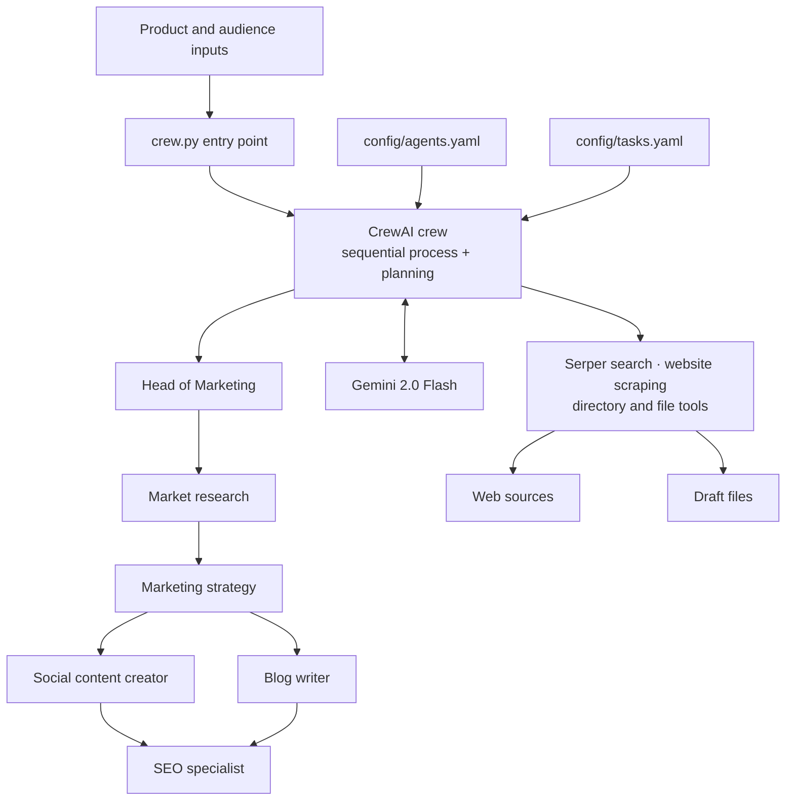

# Marketing Crew

Marketing Crew is a configuration-driven, multi-agent workflow for researching a product and preparing a coordinated set of marketing deliverables. A lead marketer coordinates specialist agents for social media, blog writing, and SEO. CrewAI runs the tasks in sequence, using a Gemini model and web research tools.

The repository includes the crew implementation, YAML configuration, and example marketing research and content drafts. It does not currently include a web app, hosted service, or public live demo.

## Contents

- [Features](#features)
- [Architecture](#architecture)
- [Repository layout](#repository-layout)
- [Technologies](#technologies)
- [Setup](#setup)
- [Run](#run)
- [Configuration](#configuration)
- [Design decisions](#design-decisions)
- [Current implementation notes](#current-implementation-notes)
- [Example output](#example-output)

## Features

- Research market trends, competitors, and customer needs.
- Develop a marketing strategy and a one-week content calendar.
- Draft social posts, email campaigns, short-form video scripts, and blog content.
- Run SEO optimization over planned blog content.
- Use structured Pydantic output for selected content-generation tasks.
- Read and write files and gather web information through CrewAI tools.

## Architecture



At runtime, `crew.py` loads the agent and task definitions from `config/`, builds a `Crew` with `Process.sequential`, and calls `kickoff()` with product details. Each task's expected output and requested file destinations are described in `config/tasks.yaml`.

## Repository layout

```text
.
├── crew.py                         # CrewAI agents, tasks, crew, and example entry point
├── config/
│   ├── agents.yaml                 # Agent roles, goals, and backstories
│   └── tasks.yaml                  # Task prompts, expected outputs, and destinations
└── data/
    └── saved_drafts/               # Checked-in example research and marketing drafts
        ├── posts/
        └── reels/
```

## Technologies

| Technology | Use |
| --- | --- |
| Python | Application runtime and crew definition |
| [CrewAI](https://docs.crewai.com/) | Agent, task, and sequential crew orchestration |
| [Google Gemini 2.0 Flash](https://ai.google.dev/gemini-api/docs) | Language model configured for agents and crew planning |
| [CrewAI Tools](https://docs.crewai.com/en/concepts/tools) | Serper search, website scraping, and file/directory tools |
| [Serper](https://serper.dev/) | Web search provider used by `SerperDevTool` |
| [Pydantic](https://docs.pydantic.dev/) | Structured content output schema |
| [python-dotenv](https://github.com/theskumar/python-dotenv) | Loads local environment variables from `.env` |
| YAML | Agent and task configuration files |

## Setup

### Requirements

- Python and `pip`, in versions supported by the installed CrewAI release.
- A Gemini API key.
- A Serper API key for web search.

### Install

Clone the repository and create an isolated environment:

```bash
git clone <repository-url>
cd marketing-crew
python -m venv .venv
source .venv/bin/activate
```

On Windows PowerShell, activate the environment with:

```powershell
.venv\Scripts\Activate.ps1
```

Install the packages imported by the current implementation:

```bash
python -m pip install --upgrade pip
python -m pip install crewai crewai-tools pydantic python-dotenv
```

The repository does not yet include a dependency manifest or lockfile, so this command installs the latest compatible releases available when run.

### Configure API keys

Create a `.env` file in the repository root:

```dotenv
GEMINI_API_KEY=your_gemini_api_key
SERPER_API_KEY=your_serper_api_key
```

Keep real credentials private. `.env` is excluded by `.gitignore`; do not commit API keys.

## Run

The example entry point is:

```bash
python crew.py
```

It invokes the crew with a sample product, target audience, budget, and current date defined in the `__main__` block of `crew.py`. To use another brief, update the `inputs` dictionary there. Its keys must match the placeholders used in `config/tasks.yaml`:

| Input | Purpose |
| --- | --- |
| `product_name` | Product or service name |
| `product_description` | Product summary and value proposition |
| `target_audience` | Intended customer group |
| `budget` | Marketing budget passed into research |
| `current_date` | Date context used in task prompts |

CrewAI logs execution details to the terminal. Output destinations are specified in the task prompts under `config/tasks.yaml`; see [Current implementation notes](#current-implementation-notes) for the current path mismatch.

## Configuration

- **Agents:** `config/agents.yaml` defines each agent's role, goal, backstory, and model name.
- **Tasks:** `config/tasks.yaml` defines the work, input placeholders, expected outputs, and requested draft locations.
- **Runtime options:** `crew.py` selects the Gemini model, temperature, tools, iteration and request limits, and sequential execution with planning enabled.
- **Structured outputs:** `Content` in `crew.py` specifies the `content_type`, `topic`, `target_audience`, `tags`, and `content` fields for tasks configured with `output_json`.

## Design decisions

- **YAML keeps prompts editable:** Agent descriptions and task instructions can be refined without changing the Python orchestration code.
- **Sequential execution preserves context:** Research and strategy are defined before downstream content tasks run, matching the intended dependency between deliverables.
- **Specialists have focused tools and limits:** Agents receive file and research tools, with per-agent iteration limits to constrain task execution.
- **Structured output supports review:** Selected content tasks use a Pydantic schema so their result can be represented consistently.
- **Draft-first workflow:** Tasks ask agents to save reviewable marketing materials rather than publishing content directly.

## Current implementation notes

The repository is an early implementation and currently has configuration mismatches that prevent the documented command from completing as-is:

1. In `crew.py`, the content-related task methods call `self.content_writer_social_media()`, but the declared agent method is named `content_creator_social_media()`. This raises an attribute error while constructing the crew.
2. The tools and task prompts refer to `resources/drafts/` and subdirectories, while the checked-in examples are under `data/saved_drafts/`. The runtime paths are not currently aligned with the repository layout.
3. No dependency manifest, automated tests, CI workflow, or hosted demo is included in the repository.

Resolve the agent method name and choose a consistent draft directory before relying on `python crew.py` for a full run. The setup above documents the dependencies implied by the imports in `crew.py`.

## Example output

Example artifacts are checked into [`data/saved_drafts/`](data/saved_drafts/), including:

- [Market research report](data/saved_drafts/market_research_report.md)
- [Marketing strategy](data/saved_drafts/marketing_strategy.md)
- [Content calendar](data/saved_drafts/content_calendar.md)
- [Social media posts](data/saved_drafts/posts/)
- [Reel script](data/saved_drafts/reels/reel_script_time_savings.md)

These are sample files for browsing; they are not presented as output from a currently hosted live demo.
